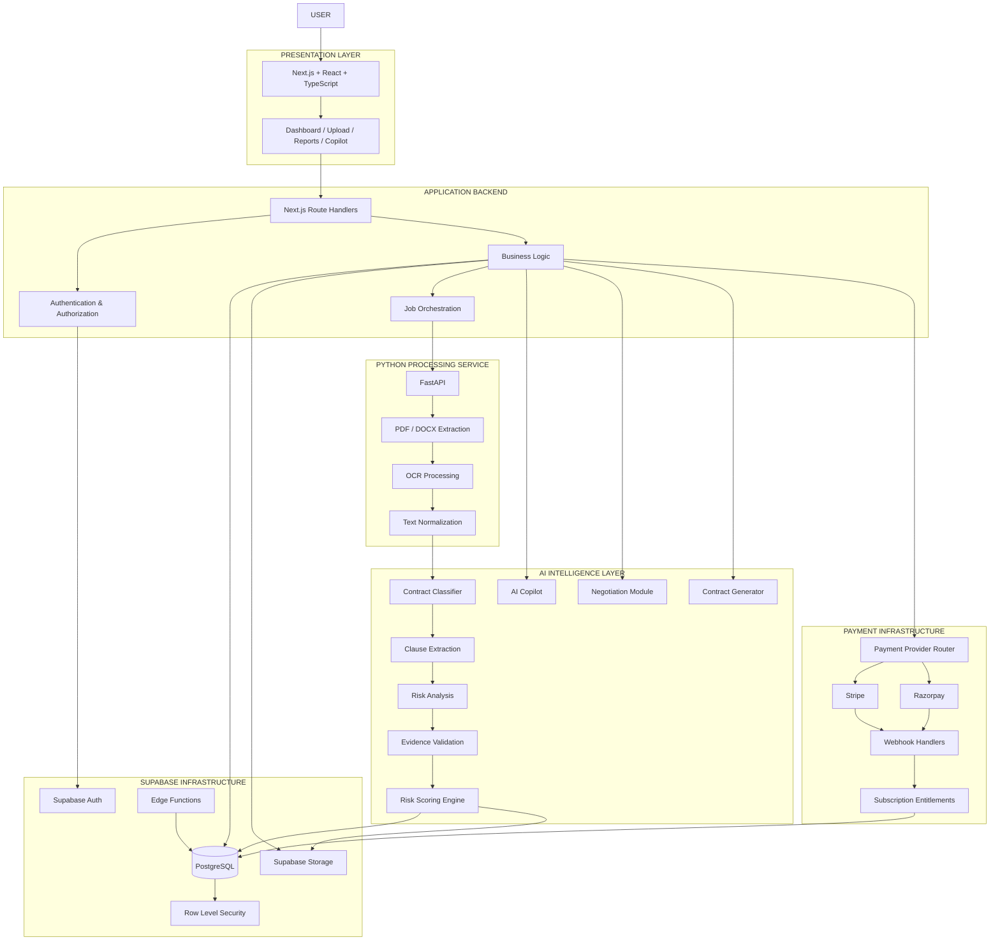
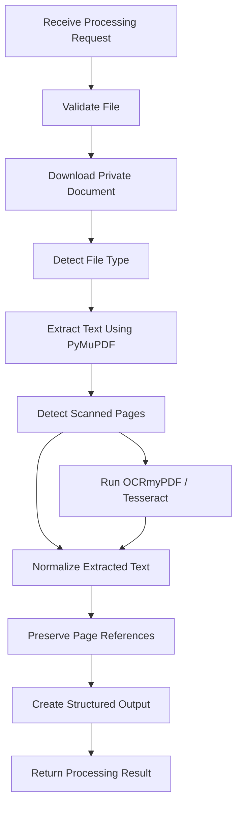
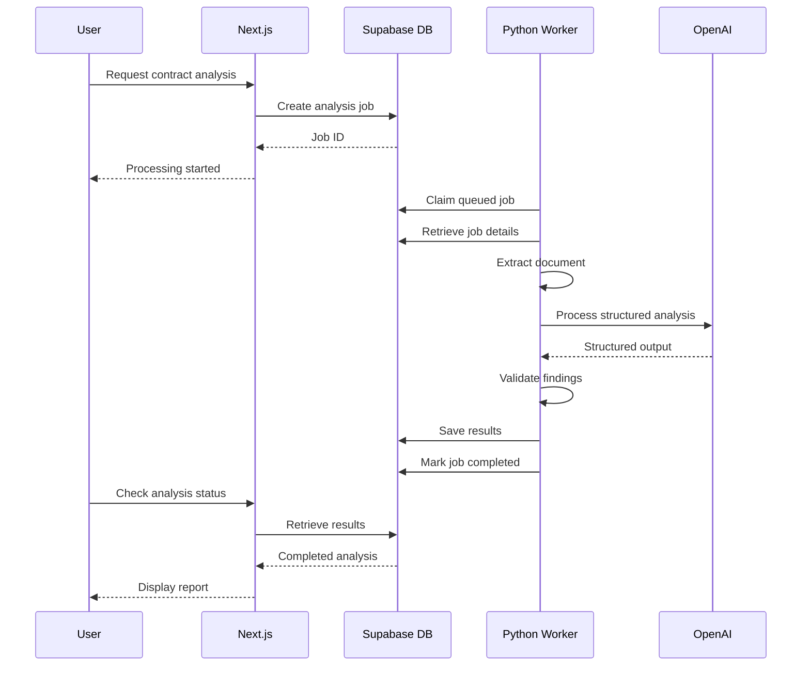
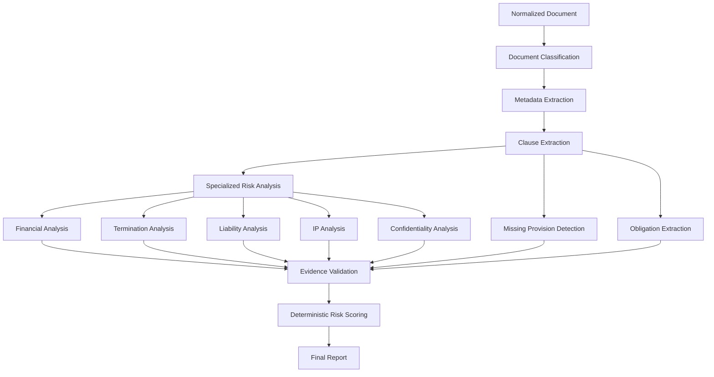
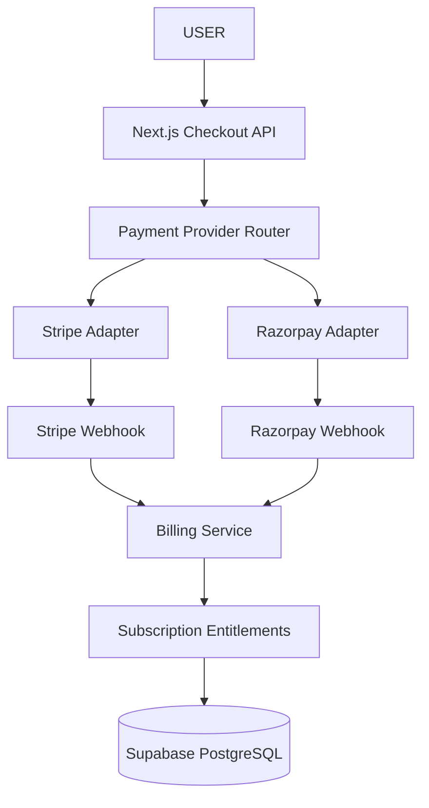

# DEALSAFE AI
# Implementation-Ready Technical Architecture & Engineering Specification

**Document Version:** 1.1  
**Status:** Finalized for Implementation  
**Product:** AI Contract Intelligence Platform  
**Architecture:** Modular Monolith + Python Processing Microservice  
**Target Market:** Global  
**Initial Release:** MVP  
**Deployment Strategy:** Cloud-based

---

# 1. Architecture Decisions

The following decisions are final for the initial implementation.

| Component | Decision |
|---|---|
| Frontend | Next.js + React |
| Language | TypeScript |
| Backend application | Next.js |
| Backend infrastructure | Supabase |
| Database | Supabase PostgreSQL |
| Authentication | Supabase Auth |
| File storage | Supabase Storage |
| Document processing | Python microservice |
| Python framework | FastAPI |
| PDF extraction | PyMuPDF |
| OCR | Tesseract + OCRmyPDF |
| AI provider | OpenAI API |
| AI architecture | Structured specialized pipeline |
| Background processing | PostgreSQL-backed job queue |
| Payment providers | Stripe + Razorpay |
| Deployment | Vercel + Supabase + Python hosting |
| Monitoring | Sentry |

## 1.1 Architectural Principles

1. Modular architecture with clearly separated responsibilities.
2. Secure document processing.
3. Evidence-backed AI analysis.
4. Deterministic risk scoring.
5. Provider-independent payment architecture.
6. Asynchronous processing for expensive tasks.
7. Database-level authorization.
8. Scalable infrastructure without premature microservices.
9. Versioned APIs and database migrations.
10. Testable and independently deployable processing services.

---

# 2. Complete System Architecture

## 2.1 High-Level Architecture



## 2.2 Architecture Responsibilities

### Next.js Application

Responsible for:
- User interface.
- Authentication integration.
- Session validation.
- API endpoints.
- Authorization.
- Business logic.
- Contract orchestration.
- AI request orchestration.
- Payment integration.
- Subscription enforcement.
- Report delivery.

### Supabase

Responsible for:
- User authentication.
- PostgreSQL database.
- Private document storage.
- Database access policies.
- Row Level Security.
- Database functions.
- Lightweight serverless functions.

### Python FastAPI Service

Responsible for:
- PDF extraction.
- DOCX extraction.
- OCR.
- Page-level text mapping.
- Document normalization.
- Document metadata extraction.
- Processing large files.
- Returning structured extraction results.

### OpenAI Intelligence Layer

Responsible for:
- Contract classification.
- Clause identification.
- Risk analysis.
- Missing provision detection.
- Contract explanations.
- Negotiation assistance.
- Document generation.
- Contract-related question answering.

### Payment Infrastructure

Responsible for:
- Stripe payments.
- Razorpay payments.
- Checkout sessions.
- Subscription lifecycle.
- Payment verification.
- Webhook handling.
- Billing status.
- Subscription entitlements.

---

# 3. Frontend Implementation Specification

## 3.1 Framework

Next.js with the App Router.

Recommended configuration:
- Next.js with React.
- TypeScript strict mode.
- Tailwind CSS.
- shadcn/ui.
- Lucide React.
- React Hook Form.
- Zod.
- TanStack Query.
- PDF.js.

## 3.2 Application Routes

```text
app/
│
├── (marketing)/
│   ├── page.tsx
│   ├── pricing/
│   ├── features/
│   └── about/
│
├── (auth)/
│   ├── login/
│   ├── signup/
│   └── reset-password/
│
├── dashboard/
│   ├── page.tsx
│   ├── analyze/
│   ├── reports/
│   ├── copilot/
│   ├── negotiation/
│   ├── generator/
│   ├── compare/
│   ├── vault/
│   ├── obligations/
│   ├── workspace/
│   ├── billing/
│   └── settings/
│
└── api/
    └── v1/
        ├── contracts/
        ├── analyses/
        ├── copilot/
        ├── negotiations/
        ├── documents/
        ├── comparisons/
        ├── obligations/
        ├── billing/
        └── webhooks/
```

## 3.3 Frontend Responsibilities

The frontend must:

1. Display the complete dashboard.
2. Handle user interaction.
3. Upload documents using secure upload flows.
4. Display document-processing progress.
5. Render PDF documents.
6. Highlight detected clauses.
7. Display risk assessments.
8. Provide AI chat functionality.
9. Display contract comparisons.
10. Provide subscription management.

## 3.4 State Management

Use:

- React state for local UI state.
- TanStack Query for server state.
- React Hook Form for form state.
- Supabase Auth for session state.

Avoid duplicating server data unnecessarily in global client state.

---

# 4. Next.js Backend Specification

Next.js will be the main application backend.

## 4.1 Responsibilities

- Authenticate requests.
- Validate sessions.
- Verify resource ownership.
- Validate request payloads.
- Enforce subscription limits.
- Create processing jobs.
- Coordinate Python services.
- Coordinate OpenAI calls.
- Manage payment sessions.
- Handle webhook events.
- Store analysis results.

## 4.2 API Structure

All APIs use:

`/api/v1/`

### Contract APIs

| Method | Endpoint | Purpose |
|---|---|---|
| POST | `/contracts/upload` | Initiate document upload |
| GET | `/contracts` | List contracts |
| GET | `/contracts/:id` | Retrieve contract |
| PATCH | `/contracts/:id` | Update metadata |
| DELETE | `/contracts/:id` | Delete contract |

### Analysis APIs

| Method | Endpoint | Purpose |
|---|---|---|
| POST | `/contracts/:id/analyze` | Start analysis |
| GET | `/analyses/:id` | Get analysis |
| GET | `/analyses/:id/findings` | Get findings |
| GET | `/analyses/:id/report` | Download report |

### AI APIs

| Method | Endpoint | Purpose |
|---|---|---|
| POST | `/copilot/sessions` | Create chat session |
| POST | `/copilot/sessions/:id/messages` | Ask a question |
| POST | `/negotiations` | Start negotiation session |
| POST | `/negotiations/:id/suggestions` | Generate suggestions |

### Contract Generation APIs

| Method | Endpoint | Purpose |
|---|---|---|
| GET | `/templates` | List templates |
| POST | `/documents/generate` | Generate draft |
| GET | `/documents/:id` | Retrieve draft |

### Comparison APIs

| Method | Endpoint | Purpose |
|---|---|---|
| POST | `/comparisons` | Start comparison |
| GET | `/comparisons/:id` | Retrieve results |

### Management APIs

| Method | Endpoint | Purpose |
|---|---|---|
| GET | `/vault` | List saved contracts |
| GET | `/obligations` | List obligations |
| POST | `/obligations` | Create obligation |
| PATCH | `/obligations/:id` | Update obligation |
| GET | `/reminders` | List reminders |

---

# 5. Python Document Processing Microservice

This is a separate service from the Next.js application.

## 5.1 Technology

| Component | Technology |
|---|---|
| Language | Python |
| Framework | FastAPI |
| PDF extraction | PyMuPDF |
| DOCX extraction | python-docx |
| OCR | Tesseract |
| OCR preprocessing | OCRmyPDF |
| Image processing | Pillow |
| Data validation | Pydantic |
| HTTP client | HTTPX |
| Testing | Pytest |

## 5.2 Microservice Responsibilities

The Python service handles computationally intensive document processing.

It does not manage:
- User authentication.
- Payments.
- Subscription billing.
- Main application authorization.
- User-facing dashboard logic.

Those responsibilities remain with Next.js and Supabase.

## 5.3 Supported Formats

Initial supported formats:

- PDF.
- DOCX.
- Scanned PDF.

Additional formats can be introduced later.

## 5.4 Document Processing Pipeline



## 5.5 Extraction Requirements

The service must preserve:

- Page number.
- Text content.
- Section heading.
- Clause boundaries where detectable.
- Paragraph ordering.
- Character offsets.
- Extraction method.
- OCR confidence where available.

Do not flatten the entire document into one unstructured text string.

Page-level references are essential for highlighting findings in the PDF viewer.

## 5.6 FastAPI Endpoints

| Method | Endpoint | Purpose |
|---|---|---|
| GET | `/health` | Health check |
| POST | `/internal/v1/extract` | Extract document text |
| POST | `/internal/v1/ocr` | Process scanned document |
| GET | `/internal/v1/jobs/:id` | Retrieve processing status |

These are private internal endpoints.

They must require service authentication and must never be exposed as unrestricted public APIs.

## 5.7 Extraction Response Schema

Example:

```json
{
  "document_id": "uuid",
  "status": "completed",
  "file_type": "pdf",
  "page_count": 5,
  "pages": [
    {
      "page_number": 1,
      "text": "Agreement between Party A and Party B...",
      "extraction_method": "pymupdf",
      "ocr_used": false
    },
    {
      "page_number": 2,
      "text": "Payment obligations...",
      "extraction_method": "tesseract",
      "ocr_used": true
    }
  ],
  "metadata": {
    "language": "en",
    "processing_duration_ms": 1250
  }
}
```

The response schema must be validated with Pydantic.

## 5.8 Processing Security

- Validate MIME type and file signatures.
- Enforce document size and page-count limits.
- Scan files before processing.
- Prevent path traversal.
- Use temporary isolated processing directories.
- Restrict network access.
- Delete temporary files after processing.
- Never execute uploaded document content.
- Do not trust document metadata.
- Use short-lived access to private files.

---

# 6. Background Job Architecture

Document processing and AI analysis must run asynchronously.

For the initial implementation, use a PostgreSQL-backed queue.

A dedicated jobs table will coordinate Next.js and the Python worker.

## 6.1 Job Flow



## 6.2 Jobs Table

Required fields:

- id
- user_id
- workspace_id
- job_type
- resource_id
- status
- priority
- attempts
- max_attempts
- available_at
- locked_at
- locked_by
- last_error
- created_at
- completed_at

## 6.3 Queue Requirements

- Atomic job claiming.
- Retry with exponential backoff.
- Job timeout.
- Maximum retry count.
- Failed-job handling.
- Idempotent processing.
- Job status tracking.
- Worker heartbeat.
- Dead-letter handling for repeatedly failed jobs.

Use PostgreSQL transactions and `FOR UPDATE SKIP LOCKED` or an equivalent atomic database function to claim jobs safely.

Do not let multiple workers process the same job simultaneously.

For higher volume, the queue can later be replaced with a managed queue without changing the overall application workflow.

---

# 7. Structured AI Architecture

## 7.1 Final AI Design

Use specialized AI modules coordinated through a central orchestration layer.

Do not implement autonomous agents that can execute arbitrary actions.

Each module has a specific task, input schema and output schema.

## 7.2 AI Modules

| Module | Responsibility |
|---|---|
| Document Classifier | Identify contract category |
| Metadata Extractor | Identify parties, dates and amounts |
| Clause Extractor | Extract contractual provisions |
| Risk Analyzer | Detect potential risks |
| Missing Clause Analyzer | Identify provisions not found |
| Financial Analyzer | Analyze financial commitments |
| Obligation Extractor | Extract responsibilities and dates |
| Evidence Validator | Verify findings against original text |
| Risk Scoring Engine | Calculate deterministic risk score |
| Contract Copilot | Answer document-grounded questions |
| Negotiation Copilot | Suggest negotiation points |
| Contract Generator | Generate first-draft agreements |
| Comparison Engine | Identify differences between versions |

## 7.3 AI Processing Sequence



## 7.4 Structured Output

All AI modules must return validated JSON.

Example risk finding:

```json
{
  "title": "Broad Intellectual Property Ownership",
  "category": "intellectual_property",
  "severity": "high",
  "clause_reference": {
    "page": 4,
    "clause_title": "Ownership of Deliverables",
    "quoted_text": "All deliverables shall belong exclusively to the client."
  },
  "explanation": "The provision appears to assign ownership broadly and may affect pre-existing materials depending on its scope.",
  "recommended_action": "Clarify treatment of pre-existing materials and reusable tools.",
  "confidence": 0.94,
  "evidence_verified": true
}
```

The system must distinguish:

- Source evidence.
- AI interpretation.
- Suggested action.
- Confidence.
- Missing information.

## 7.5 Risk Scoring

Initial configurable weighting:

| Category | Weight |
|---|---:|
| Financial liability | 25% |
| Termination and renewal | 20% |
| Intellectual property | 20% |
| Payment conditions | 15% |
| Indemnification | 10% |
| Confidentiality | 10% |

The scoring engine must:

1. Receive validated findings.
2. Apply documented severity rules.
3. Consider relevant contract playbook rules.
4. Apply configured category weights.
5. Handle missing or unavailable evidence.
6. Generate an explainable score.
7. Record the rubric version.

Do not assign zero risk to a category merely because the AI failed to analyze it.

Scores are product indicators, not legal determinations or probabilities of harm.

## 7.6 AI Model Configuration

Keep model selection configurable.

Store:
- Model identifier.
- Prompt version.
- Output schema version.
- Temperature or supported generation settings.
- Token usage.
- Processing duration.
- Evaluation status.

Use smaller, cost-efficient models for suitable classification and extraction tasks, and more capable models for complex analysis where evaluation justifies the additional cost.

Do not hardcode model names throughout the application.

---

# 8. Payment Architecture — Stripe + Razorpay

Both providers will be supported from launch.

Use a provider-independent billing layer.

## 8.1 Payment Architecture



## 8.2 Payment Provider Selection

The provider router must consider:

- Customer country.
- Billing currency.
- Merchant account eligibility.
- Supported payment method.
- Subscription capability.
- Product configuration.

The application must not assume that every provider supports every country, currency or recurring billing scenario.

Keep provider selection configurable rather than permanently hardcoding country rules.

## 8.3 Payment Provider Interface

Create a common TypeScript interface.

```typescript
interface PaymentProvider {
  createCheckout(input: CheckoutInput): Promise<CheckoutResult>;

  verifyWebhook(
    payload: string | Buffer,
    signature: string
  ): Promise<VerifiedPaymentEvent>;

  getSubscription(
    providerSubscriptionId: string
  ): Promise<SubscriptionDetails>;

  cancelSubscription(
    providerSubscriptionId: string
  ): Promise<CancelResult>;
}
```

Implement:

```text
payments/
├── providers/
│   ├── stripe.provider.ts
│   └── razorpay.provider.ts
│
├── payment-router.ts
├── billing.service.ts
├── subscription.service.ts
├── entitlement.service.ts
└── webhook.service.ts
```

## 8.4 Webhook Requirements

Stripe:
- Verify Stripe webhook signatures.
- Handle checkout completion.
- Handle invoice payment.
- Handle subscription updates.
- Handle cancellation.
- Handle failed payments.

Razorpay:
- Verify webhook signatures.
- Handle payment success.
- Handle payment failure.
- Handle subscription events supported by the integration.
- Handle cancellation and billing updates.

For both:

- Use raw webhook request bodies.
- Store provider event IDs.
- Process events idempotently.
- Reject invalid signatures.
- Handle duplicate events.
- Avoid relying on event arrival order.
- Reconcile subscription state with the provider when necessary.

## 8.5 Subscription Entitlements

Create a provider-independent entitlement system.

Example:

```json
{
  "user_id": "uuid",
  "plan": "pro",
  "status": "active",
  "limits": {
    "monthly_analyses": 10,
    "comparisons": 5,
    "team_members": 1
  },
  "features": [
    "full_analysis",
    "pdf_annotations",
    "ai_copilot",
    "negotiation_assistant"
  ]
}
```

Never use a frontend plan label as proof of payment.

All paid features must be checked server-side against authoritative subscription and entitlement records.

---

# 9. Supabase Database Specification

## 9.1 Core Tables

```text
profiles
workspaces
workspace_members
contracts
contract_versions
contract_analyses
contract_clauses
risk_findings
contract_obligations
reminders
contract_playbooks
generated_documents
document_comparisons
chat_sessions
chat_messages
negotiation_sessions
negotiation_suggestions
subscriptions
subscription_items
payment_events
usage_records
analysis_jobs
audit_logs
notifications
```

## 9.2 Additional Important Fields

### analysis_jobs

- id
- job_type
- user_id
- resource_id
- status
- attempts
- max_attempts
- available_at
- locked_at
- locked_by
- last_error
- created_at
- completed_at

### subscriptions

- id
- user_id
- provider
- provider_customer_id
- provider_subscription_id
- plan_id
- billing_currency
- status
- current_period_start
- current_period_end

### payment_events

- id
- provider
- provider_event_id
- event_type
- processing_status
- payload_reference
- received_at
- processed_at

### usage_records

- id
- user_id
- workspace_id
- action_type
- resource_id
- units_used
- estimated_cost
- created_at

## 9.3 Database Rules

- UUID primary keys.
- Foreign keys.
- Appropriate indexes.
- Database migrations.
- Row Level Security.
- Workspace-level access control.
- Restricted storage policies.
- Unique webhook event constraints.
- Unique idempotency keys.
- Transactional subscription updates.

---

# 10. Security Architecture

## 10.1 Authentication

Supabase Auth will manage:
- Signup.
- Login.
- Password reset.
- Email verification.
- Session management.
- OAuth where configured.

Next.js must validate the authenticated user on protected server requests.

## 10.2 Authorization

Implement:

- User-level resource ownership.
- Workspace membership checks.
- Role-based access.
- Row Level Security.
- Server-side permission validation.
- Storage access policies.

## 10.3 Secret Management

Never expose:

- Supabase service-role key.
- OpenAI API key.
- Stripe secret key.
- Razorpay secret key.
- Webhook signing secrets.
- Python service credentials.

Use environment-specific secret management.

## 10.4 Document Security

- Private Supabase buckets.
- Short-lived signed URLs.
- File size limits.
- MIME validation.
- File signature validation.
- Malware scanning.
- Isolated temporary processing.
- Retention policies.
- Secure deletion.

## 10.5 Python Service Security

- Private service networking where available.
- Service-to-service authentication.
- Request signing or equivalent authentication.
- Rate limiting.
- Strict input schemas.
- Restricted network access.
- No public unrestricted processing endpoint.

## 10.6 AI Security

- Treat document contents as untrusted.
- Protect against prompt injection.
- Prevent cross-user document access.
- Validate all model responses.
- Verify source evidence.
- Avoid unsupported legal conclusions.
- Do not execute instructions embedded in uploaded documents.

---

# 11. Deployment Architecture

## 11.1 Vercel

Deploy:
- Next.js frontend.
- Next.js backend APIs.
- Server Components.
- Server Actions.
- Route Handlers.

## 11.2 Supabase Cloud

Deploy:
- PostgreSQL.
- Auth.
- Storage.
- RLS policies.
- Database migrations.
- Edge Functions.

## 11.3 Python Hosting

Deploy FastAPI and background workers on a Python-capable container hosting service.

Requirements:
- Persistent worker execution.
- Environment variable support.
- CPU and memory allocation.
- Private service access.
- Logging.
- Health checks.
- Restart policies.

Do not assume Vercel will run a long-lived Python worker.

## 11.4 OpenAI

Configure:
- API key.
- Model settings.
- Output schemas.
- Usage limits.
- Monitoring.

## 11.5 Payment Providers

Configure separate Stripe and Razorpay environments, webhook endpoints and credentials.

## 11.6 Environment Separation

Maintain:

```text
DEVELOPMENT
STAGING
PRODUCTION
```

Each environment should have independent:
- Supabase project/configuration.
- Storage buckets.
- API credentials.
- Payment credentials.
- Webhook endpoints.
- Deployment settings.

---

# 12. Repository Architecture

```text
dealsafe-ai/
│
├── apps/
│   └── web/
│       ├── app/
│       ├── components/
│       ├── hooks/
│       ├── lib/
│       ├── schemas/
│       ├── types/
│       └── public/
│
├── services/
│   └── document-processing/
│       ├── app/
│       │   ├── api/
│       │   ├── core/
│       │   ├── extractors/
│       │   ├── ocr/
│       │   ├── normalizers/
│       │   ├── schemas/
│       │   └── workers/
│       │
│       ├── tests/
│       ├── requirements.txt
│       └── Dockerfile
│
├── packages/
│   ├── shared-types/
│   ├── validation/
│   └── api-contracts/
│
├── supabase/
│   ├── migrations/
│   ├── functions/
│   └── seed.sql
│
├── docs/
│   ├── PRD.md
│   ├── ARCHITECTURE.md
│   ├── DATABASE.md
│   ├── API.md
│   ├── AI_PIPELINE.md
│   ├── SECURITY.md
│   └── DEPLOYMENT.md
│
├── docker-compose.yml
├── .env.example
├── package.json
└── README.md
```

This is the recommended monorepo organization. Keep the Next.js application and Python processing service in separate deployable units.

---

# 13. Testing Strategy

## Frontend Testing

- Component tests.
- Form validation.
- Dashboard interactions.
- Upload interface.
- PDF viewer.
- Responsive design.

## Backend Testing

- API authorization.
- Input validation.
- Contract ownership.
- Usage enforcement.
- Payment integration.
- Webhook idempotency.

## Python Testing

- PDF extraction.
- DOCX extraction.
- OCR.
- Page references.
- Invalid document handling.
- Large document processing.
- Temporary-file cleanup.

## AI Testing

- Contract classification accuracy.
- Clause extraction accuracy.
- Risk finding precision and recall.
- Evidence quotation accuracy.
- Page-reference validity.
- False-positive analysis.
- Missing clause detection.
- Unsupported conclusion detection.
- Prompt-injection resistance.

## Payment Testing

- Successful checkout.
- Failed checkout.
- Duplicate webhooks.
- Subscription cancellation.
- Refund events.
- Renewal.
- Entitlement synchronization.

---

# 14. Implementation Roadmap

## Phase 1 — Foundation

- Create repository.
- Initialize Next.js.
- Configure TypeScript.
- Configure Supabase.
- Set up authentication.
- Create initial database migrations.
- Configure storage buckets.
- Create dashboard layout.

## Phase 2 — Document Processing

- Create FastAPI service.
- Implement PDF extraction.
- Implement DOCX extraction.
- Implement OCR.
- Preserve page references.
- Create extraction response schemas.
- Connect Next.js to FastAPI.

## Phase 3 — AI Intelligence

- Implement document classifier.
- Implement metadata extraction.
- Implement clause extraction.
- Implement risk analysis modules.
- Implement evidence validation.
- Implement deterministic scoring.
- Save results to Supabase.

## Phase 4 — Core User Experience

- Build contract upload.
- Build processing status interface.
- Build analysis report.
- Build PDF highlighting.
- Build report download.
- Build analysis history.

## Phase 5 — AI Expansion

- Build Contract Copilot.
- Build Negotiation Copilot.
- Build Contract Generator.
- Build Contract Comparison.

## Phase 6 — Payments

- Create payment provider abstraction.
- Implement Stripe adapter.
- Implement Razorpay adapter.
- Implement webhook verification.
- Implement subscription entitlements.
- Implement usage limits.

## Phase 7 — Contract Management

- Contract Vault.
- Obligation extraction.
- Reminder scheduling.
- Email notifications.
- Team workspace.

## Phase 8 — Production Launch

- Security testing.
- AI evaluation.
- Payment testing.
- Load testing.
- Production deployment.
- Monitoring.
- Beta user feedback.

---

# 15. Definition of Done

The initial production MVP is ready when:

1. Users can register and log in.
2. Users can securely upload PDFs and DOCX files.
3. Python successfully extracts document text.
4. Scanned documents can be processed through OCR.
5. Page references are preserved.
6. The AI pipeline produces structured results.
7. Findings contain verifiable source quotations.
8. Risk scoring follows documented rules.
9. The dashboard displays complete reports.
10. PDF highlighting maps to source pages.
11. Users can download reports.
12. User data is isolated through RLS and server-side authorization.
13. Usage limits are enforced.
14. Payment provider integration works in test mode.
15. Webhooks are authenticated and idempotent.
16. Critical security tests pass.
17. AI outputs pass the agreed evaluation suite.
18. Privacy, retention and deletion workflows are available.

---

# 16. Final Technical Architecture

```text
USER
  |
  v
NEXT.JS + REACT FRONTEND
  |
  v
NEXT.JS APPLICATION BACKEND
  |
  +-------------------------+
  |                         |
  v                         v
SUPABASE                PYTHON FASTAPI
  |                         |
  |                         v
  |                    PyMuPDF / OCR
  |                         |
  |                         v
  |                    NORMALIZED TEXT
  |                         |
  |                         v
  |                    OPENAI AI PIPELINE
  |                         |
  |                         v
  |                    RISK ENGINE
  |                         |
  +<------------------------+
  |
  v
POSTGRESQL + STORAGE

PAYMENT INTEGRATION:
NEXT.JS
  |
  v
PAYMENT PROVIDER ROUTER
  |
  +-------------------+
  |                   |
  v                   v
STRIPE              RAZORPAY
  |                   |
  +---------+---------+
            |
            v
      WEBHOOK HANDLERS
            |
            v
    SUBSCRIPTION SERVICE
            |
            v
       SUPABASE DB

DEPLOYMENT:
NEXT.JS       -> VERCEL
SUPABASE      -> SUPABASE CLOUD
PYTHON        -> CONTAINER HOSTING
AI            -> OPENAI API
PAYMENTS      -> STRIPE + RAZORPAY
```

**Final Architecture Decision:**

DealSafe AI will use Next.js and React as the primary application framework, Supabase as the managed backend and database infrastructure, a Python FastAPI microservice for document extraction and OCR, a structured specialized OpenAI pipeline for contract intelligence, and Stripe and Razorpay behind a unified payment-provider abstraction.

The system will initially use a modular monolith with a dedicated document-processing service and asynchronous background workers.

**Primary engineering objective:** Build a secure, evidence-backed, cost-controlled contract intelligence platform that can evolve into a global contract lifecycle management SaaS.
